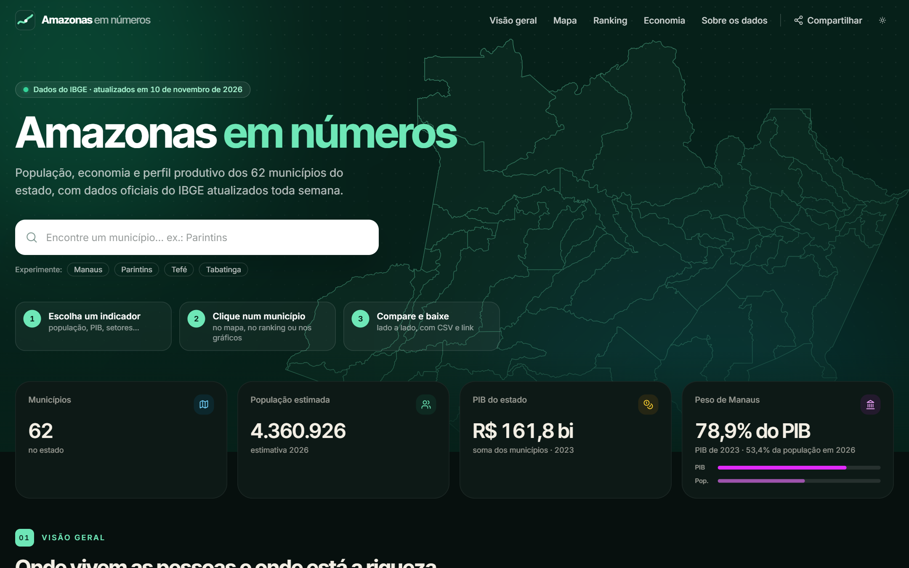
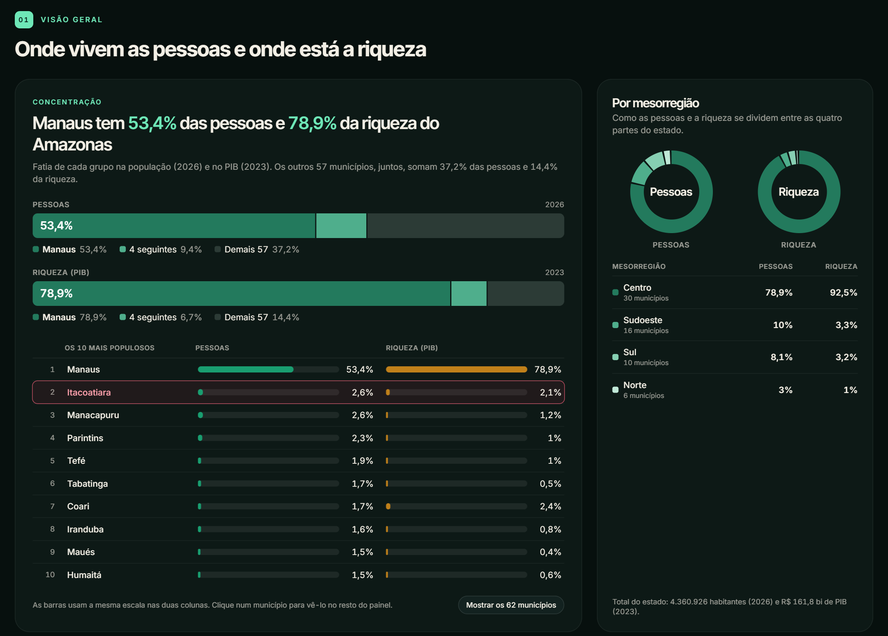
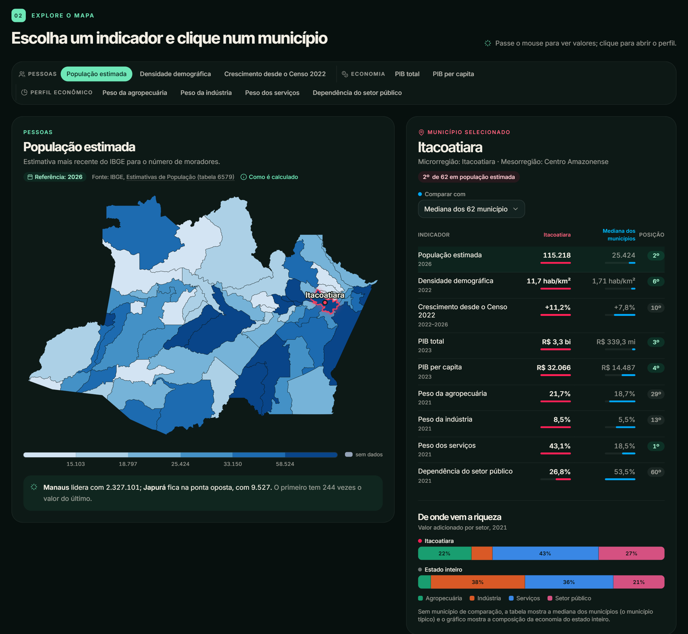
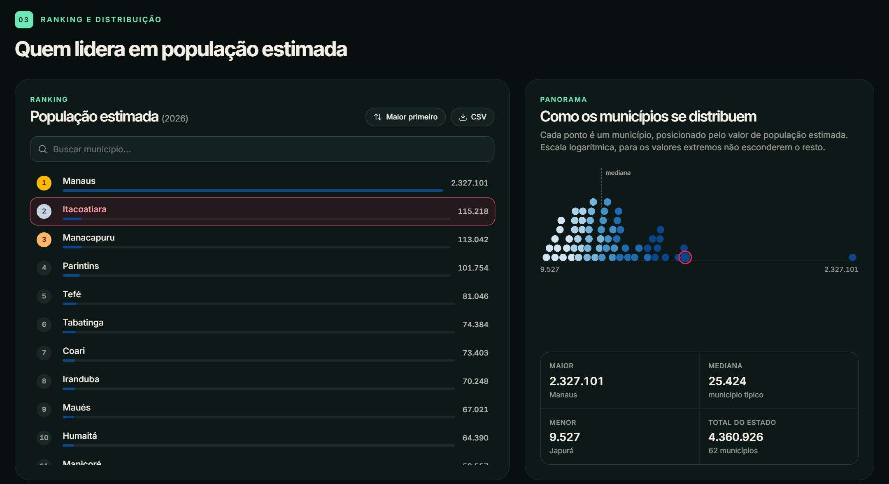
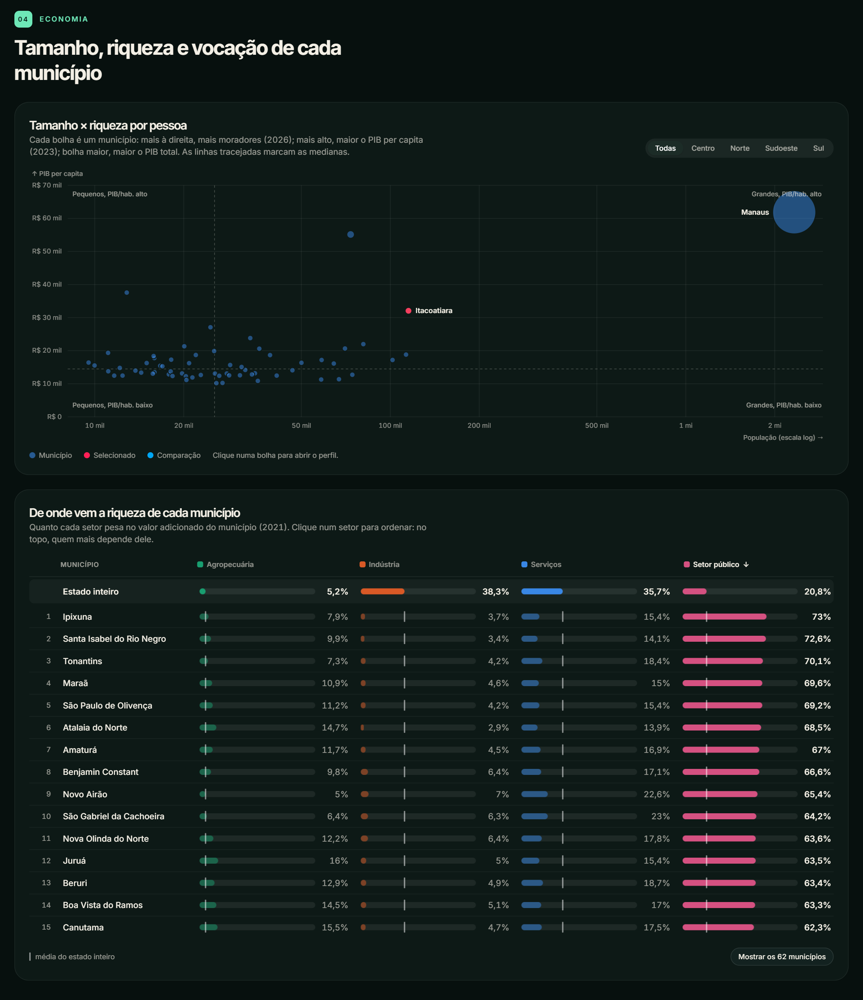
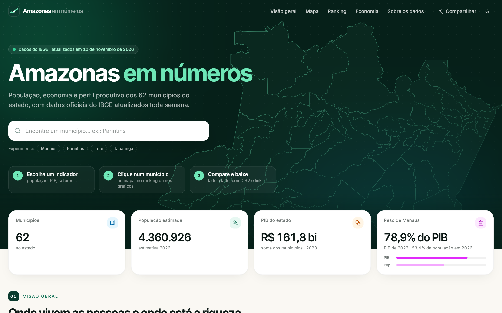
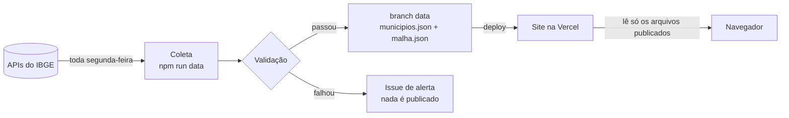

<div align="center">

# Amazonas em números

**População, economia e perfil produtivo dos 62 municípios do Amazonas, com dados oficiais do IBGE atualizados toda semana.**

[](https://amazonas-dashboard.vercel.app)
[](https://github.com/iegosoft/amazonas-dashboard/actions/workflows/ci.yml)
[](https://github.com/iegosoft/amazonas-dashboard/actions/workflows/dados.yml)
[](LICENSE)

[**Abrir o painel →**](https://amazonas-dashboard.vercel.app)



</div>

## Sumário

- [O que é](#o-que-é)
- [Tour pelo painel](#tour-pelo-painel)
- [Funcionalidades](#funcionalidades)
- [Indicadores](#indicadores)
- [De onde vêm os dados](#de-onde-vêm-os-dados)
- [Rodando localmente](#rodando-localmente)
- [Estrutura do projeto](#estrutura-do-projeto)
- [Stack](#stack)
- [Deploy e automação](#deploy-e-automação)
- [Contribuindo](#contribuindo)
- [Licença](#licença)

## O que é

O **Amazonas em números** reúne num só lugar os principais dados públicos sobre os municípios do Amazonas: quantas pessoas vivem em cada um, quanto produzem e de quais setores vem essa riqueza. É feito para quem quer entender o estado sem baixar planilhas: estudantes, jornalistas, gestores públicos e curiosos.

- **Dados oficiais:** tudo vem das APIs públicas do IBGE, com a fonte e o ano de referência ao lado de cada número.
- **Sempre atualizado:** uma rotina automática confere o IBGE toda semana e publica os dados novos sozinha.
- **Confiável:** nenhum dado vai ao ar sem passar por uma bateria de checagens; se algo parecer errado, nada é publicado.
- **Rápido e independente:** o site não depende do IBGE estar no ar. Os dados validados são servidos pelo próprio site.

## Tour pelo painel

### 1. Visão geral: onde vivem as pessoas e onde está a riqueza

O primeiro capítulo responde em uma frase a pergunta mais importante sobre o estado: **Manaus concentra mais da metade da população e quase 80% da riqueza**. As barras comparam pessoas e PIB lado a lado, a lista mostra a fatia de cada município e as rosquinhas dividem o estado por mesorregião.



### 2. Mapa: escolha um indicador e clique num município

Mapa coroplético desenhado do zero, com 9 indicadores. Ao clicar num município, o perfil ao lado mostra todos os números dele, a posição no ranking do estado e a comparação com a mediana dos municípios (ou com outro município à escolha).



### 3. Ranking e distribuição

Ranking com busca (que ignora acentos), ordem invertida e exportação em CSV. Ao lado, cada ponto é um município, para ver de uma vez como os valores se espalham e onde fica a mediana.



### 4. Economia: tamanho, riqueza e vocação

A dispersão cruza tamanho (população) e PIB per capita, com filtro por mesorregião. Logo abaixo, cada município aparece com o peso dos quatro setores da economia, em colunas alinhadas e com a média do estado marcada, para mostrar quem depende mais de cada setor.



### Tema claro

Todo o painel tem tema claro e escuro, com cores conferidas para daltonismo nos dois.



## Funcionalidades

- **Busca de município** logo na abertura, com sugestões.
- **Mapa coroplético próprio** (SVG + `d3-geo`), sem biblioteca de mapas pronta e sem tiles. Classes por quantis, para o mapa não ficar dominado por Manaus.
- **Perfil do município** com todos os indicadores, posição no ranking e comparação com a mediana do estado ou com outro município.
- **Ranking** com busca sem acento, ordem invertida e destaque ligado ao mapa (passar o mouse ou selecionar num lugar reflete no outro).
- **Gráficos próprios**, sem biblioteca de gráficos: concentração, distribuição, dispersão e perfil setorial.
- **Exportar em CSV**, pronto para o Excel em português (`;`, vírgula decimal e acentos corretos), com fonte e data na primeira linha.
- **Compartilhar:** o estado da tela fica na URL (`?i=pibPerCapita&m=1301902&c=1302603`). No celular abre o menu de compartilhamento do sistema; no computador copia o link.
- **"Sobre os dados":** como cada indicador é calculado, a fonte exata, o calendário de divulgação do IBGE e as limitações.
- **Acessível:** navegação por teclado, `aria-label` nos municípios e gráficos, cores validadas para daltonismo, valores sempre escritos (nunca só pela cor) e respeito a `prefers-reduced-motion`.
- **Resistente a falhas:** se um bloco der erro, só ele mostra "tentar de novo"; o resto do painel continua funcionando.

## Indicadores

| Grupo | Indicador | Como é calculado | Fonte (IBGE) |
| --- | --- | --- | --- |
| Pessoas | População estimada | Estimativa anual mais recente | Agregado 6579, variável 9324 |
| Pessoas | Densidade demográfica | Habitantes por km² no Censo 2022 | Agregado 4714, variável 614 |
| Pessoas | Crescimento desde o Censo 2022 | Estimativa mais recente ÷ população do Censo 2022 | Agregados 6579 e 4714 |
| Economia | PIB total | PIB a preços correntes | Agregado 5938, variável 37 |
| Economia | PIB per capita | PIB ÷ população do Censo 2022 | Agregados 5938 e 4714 |
| Perfil econômico | Peso da agropecuária, da indústria e dos serviços; dependência do setor público | Valor adicionado do setor ÷ soma dos quatro setores | Agregado 5938, variáveis 513, 517, 6575 e 525 |

Cada número no painel mostra o seu ano de referência. Os anos variam porque o IBGE divulga cada pesquisa num calendário próprio; por exemplo, a divisão do PIB por setor sai depois do PIB total. A seção **Sobre os dados**, no próprio site, detalha cada caso.

## De onde vêm os dados



1. **Coleta** (`npm run data`): busca população, Censo, PIB, municípios e malha territorial nas APIs do IBGE.
2. **Validação** (`src/lib/validate.ts`): os dados só seguem se passarem em todas as checagens:
   - formato das respostas do IBGE (variáveis presentes, 62 municípios por série);
   - 62 municípios com código `13xxxxx`, cada um com geometria no mapa;
   - população, Censo, densidade e PIB presentes e positivos em todos;
   - participações setoriais somando 100%;
   - população total do estado numa faixa plausível;
   - em relação à coleta anterior: nenhum ano volta no tempo, nenhum município muda mais de 20% de população e o PIB do estado não muda mais de 40%.
3. **Publicação:** os arquivos validados vão para a branch [`data`](../../tree/data). Cada commit nela é uma atualização, com o resumo do que mudou.
4. **Deploy:** o build baixa os dados publicados (`npm run data:pull`), valida de novo e gera o site. Sem dados válidos, o build falha: o site nunca é publicado vazio.
5. **Navegador:** só lê `/data/municipios.json` e `/data/malha.json`; nunca chama o IBGE diretamente.

### Fontes

| Dado | Fonte |
| --- | --- |
| População estimada | [Estimativas de População](https://sidra.ibge.gov.br/tabela/6579), agregado 6579 |
| População e densidade (Censo 2022) | [Censo Demográfico 2022](https://sidra.ibge.gov.br/tabela/4714), agregado 4714 |
| PIB e valor adicionado por setor | [PIB dos Municípios](https://sidra.ibge.gov.br/tabela/5938), agregado 5938 |
| Municípios, micro e mesorregiões | [API de localidades](https://servicodados.ibge.gov.br/api/docs/localidades) v1 |
| Malha territorial | [API de malhas](https://servicodados.ibge.gov.br/api/docs/malhas) v3 |

## Rodando localmente

Pré-requisito: **Node.js 22** (versão em [`.nvmrc`](.nvmrc)).

```bash
git clone https://github.com/iegosoft/amazonas-dashboard.git
cd amazonas-dashboard
npm install
npm run dev
```

O painel abre em `http://localhost:5173`. Antes de iniciar, `npm run dev` baixa os dados já publicados; sem internet, usa o que estiver em `public/data/`.

| Comando | O que faz |
| --- | --- |
| `npm run dev` | Servidor de desenvolvimento |
| `npm test` | Testes (parser do IBGE, validação, CSV, compartilhamento, renderização) |
| `npm run lint` | Lint com oxlint |
| `npm run build` | Checagem de tipos e build de produção em `dist/` |
| `npm run preview` | Serve o build de produção localmente |
| `npm run data` | Coleta e valida os dados direto do IBGE em `public/data/` |
| `npm run data:pull` | Baixa os dados publicados na branch `data` |

> O IBGE recusa conexões vindas de fora do Brasil. Rodando `npm run data` no Brasil, a coleta vai direto ao IBGE; fora daqui, ela precisa do proxy descrito em [CONTRIBUTING.md](CONTRIBUTING.md#por-que-existe-um-proxy-em-são-paulo).

## Estrutura do projeto

```
api/
  ibge.ts            proxy em São Paulo usado pela coleta automática
scripts/
  fetch-data.ts      coleta + validação (npm run data)
  pull-data.ts       baixa os dados publicados (npm run data:pull)
src/
  App.tsx            página e capítulos
  hooks.ts           dados, tema, rolagem
  components/        Hero, Kpis, Concentration, MapView, Detail, Ranking,
                     Panorama, Scatter, SectorProfile, About, ...
  lib/
    ibge.ts          busca e interpretação das respostas do IBGE
    validate.ts      regras de validação
    data.ts          carrega os dados publicados no site
    indicators.ts    definição, fonte e método de cada indicador
    csv.ts, share.ts, format.ts, stats.ts
.github/workflows/
  ci.yml             lint, testes e build em cada push e PR
  dados.yml          atualização semanal dos dados
docs/screenshots/    imagens deste README
```

## Stack

- **Interface:** React 19, TypeScript, Tailwind CSS v4
- **Mapa e gráficos:** SVG próprio com `d3-geo`, `d3-scale` e `d3-array` (sem biblioteca de gráficos)
- **Build:** Vite
- **Testes e qualidade:** Vitest, happy-dom, oxlint
- **Hospedagem:** Vercel (site estático + uma função em São Paulo)
- **Automação:** GitHub Actions

## Deploy e automação

- **Produção:** cada versão na branch `main` é publicada na Vercel em <https://amazonas-dashboard.vercel.app>.
- **Previews:** cada pull request ganha um endereço de prévia.
- **CI:** lint, testes e build rodam em todo push e pull request.
- **Dados:** o workflow [Atualização dos dados](.github/workflows/dados.yml) roda toda segunda-feira às 08:00 (horário de Manaus). Se houver dados novos e válidos, publica e dispara o deploy; se algo falhar, abre uma issue com o relatório e não publica nada.

Detalhes da configuração (secrets, proxy e deploy hook) estão em [CONTRIBUTING.md](CONTRIBUTING.md#atualização-automática-dos-dados).

## Contribuindo

O projeto segue **Git Flow** (`main` em produção, `develop` para integração) e **Conventional Commits com emoji** (`✨ feat(mapa): ...`). O passo a passo está em [CONTRIBUTING.md](CONTRIBUTING.md), e o histórico de versões em [CHANGELOG.md](CHANGELOG.md).

## Licença

Código sob a licença [MIT](LICENSE). Os dados exibidos são do IBGE e seguem os termos de uso da fonte.
